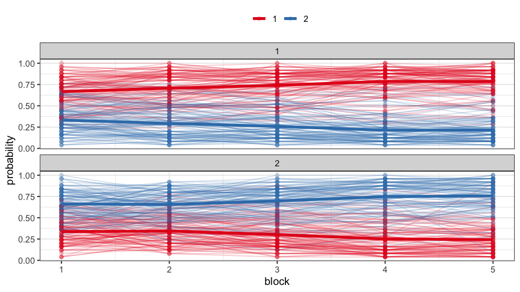
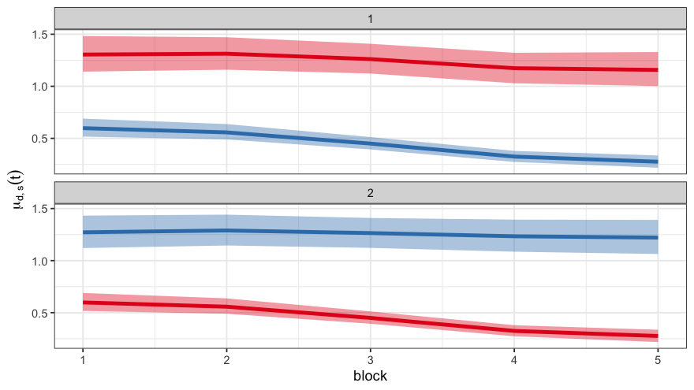
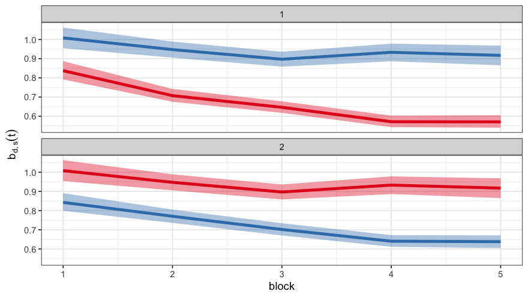
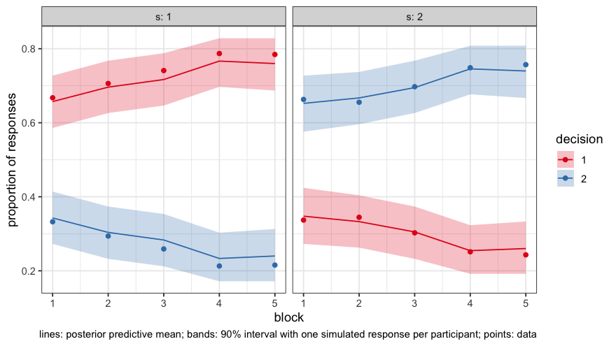
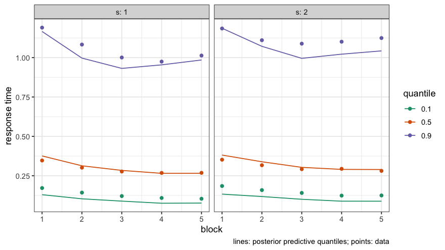
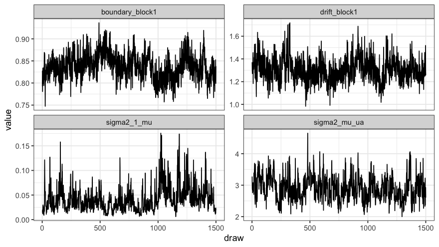

# LDDMM

An R package for Longitudinal Drift-Diffusion Mixed Models (LDDMM),
v1.0.0.

**Authors**: [Giorgio Paulon](https://giorgiopaulon.github.io/), [Abhra
Sarkar](https://abhrastat.github.io/)

### Overview

Codes accompanying “Bayesian Semiparametric Longitudinal Drift-Diffusion
Mixed Models for Tone Learning in Adults” by Paulon, Llanos,
Chandrasekaran, Sarkar.

This package implements a novel generic framework for longitudinal
functional mixed models that allows automated assessment of an
associated predictor’s local time-varying influence. We build on this to
develop a novel inverse-Gaussian drift-diffusion mixed model for
multi-alternative decision-making processes in longitudinal settings.
Our proposed model and associated computational machinery make use of
B-spline mixtures, hidden Markov models (HMM) and factorial hidden
Markov models (fHMM), locally informed Hamming ball samplers etc. to
address statistical challenges.

The main function is `LDDMM`; please see the following vignette for
details, as well as the main article:

Paulon, G., Llanos, F., Chandrasekaran, B., Sarkar, A. (2021). [Bayesian
semiparametric longitudinal drift-diffusion mixed models for tone
learning in adults](https://doi.org/10.1080/01621459.2020.1801448).
Journal of the American Statistical Association **116**, 1114-1127

The data included in this package was analyzed in:

Roark, C. L., Paulon, G., Sarkar, A., Chandrasekaran, B. (2021).
[Comparing perceptual category learning across modalities in the same
individuals](https://link.springer.com/article/10.3758/s13423-021-01878-0).
Psychonomic Bulletin & Review **28**, 898-909

and is available [here](https://osf.io/msnq2/).

### Installation

To install the package in R, first install the `devtools` package, and
then use the commands

``` r
library(devtools)
install_github('giorgiopaulon/lddmm')
```

If you are using a Windows machine, you might have to also install and
configure `Rtools` using the following
[instructions](https://CRAN.R-project.org/bin/windows/Rtools/).

### Usage

The main function is `LDDMM()`. The data are one row per trial with the
participant, the training block, the input stimulus `s`, the decision
`d`, the response time and a censoring indicator. For numerical
stability, most response times should lie in $[0, 10]$; response times
in seconds work well (the bundled data are in seconds).

``` r
library(ggplot2)
library(lddmm)
theme_set(theme_bw(base_size = 12))

data('data')
head(data)
#> # A tibble: 6 × 6
#>   subject block     s     d r_time  cens
#>     <dbl> <dbl> <dbl> <dbl>  <dbl> <dbl>
#> 1       1     1     2     1  1.63      0
#> 2       1     1     2     2  0.802     0
#> 3       1     1     1     1  1.10      0
#> 4       1     1     2     1  2.36      0
#> 5       1     1     1     2  1.73      0
#> 6       1     1     2     1  1.00      0
plot_accuracy(data)
```



#### Fitting the model

The run below uses chain settings suitable for an analysis and takes
about ten minutes; for a first look, a shorter chain such as
`Niter = 1000, burnin = 500, thin = 2` is enough.

``` r
set.seed(123)
fit <- LDDMM(data = data,
             hypers = list(s_sigma_mu = 0.1, s_sigma_b = 0.1),
             Niter = 5000, burnin = 2000, thin = 2,
             save_z = TRUE, verbose = FALSE)
```

#### Population curves

Posterior means and 90% credible bands of the drifts $\mu_{d,s}(t)$ and
the boundaries $b_{d,s}(t)$. Panels are input stimuli, colours are
decisions; the curve with $d = s$ is the correct response.

``` r
plot_post_pars(data, fit, par = 'drift')
```



``` r
plot_post_pars(data, fit, par = 'boundary')
```



#### Posterior predictive checks

For every saved draw, the fit simulates one response of every
participant to every stimulus in every block. `plot_predictive()`
compares these simulated responses with the data: the proportion of each
decision, and the 10%, 50% and 90% quantiles of the response times.

``` r
plot_predictive(data, fit, type = 'response')
```



``` r
plot_predictive(data, fit, type = 'rt')
```



#### Convergence

Trace plots of the smoothness and variance parameters and of the
population curves should fluctuate around a stable level, and the
Metropolis-Hastings acceptance rates (stored in the fit) should be
roughly between 0.2 and 0.6. Co-clustering probabilities of curves that
are only beginning to separate are estimated with more Monte Carlo error
than the curves themselves, so for those it is worth running two or more
chains with different seeds and comparing.

``` r
traces <- data.frame(draw = seq_along(fit$sigma2_1_mu),
                     sigma2_1_mu = fit$sigma2_1_mu,
                     sigma2_mu_ua = fit$sigma2_mu_ua,
                     drift_block1 = fit$post_mean_mu[1, 1, 1, ],
                     boundary_block1 = fit$post_mean_b[1, 1, 1, ])
ggplot(tidyr::pivot_longer(traces, -draw), aes(draw, value)) +
  geom_line() +
  facet_wrap(~ name, scales = 'free_y')
```



``` r
round(sapply(fit$acceptance, mean), 2)
#>        delta     beta1_mu         U_mu          U_b  sigma2_1_mu sigma2_mu_ua 
#>         0.45         0.34         0.45         0.45         0.49         0.38 
#> sigma2_mu_us  sigma2_b_ua     scale_mu      scale_b    ridge_pop   ridge_subj 
#>         0.44         0.55         0.44         0.41         0.40         0.45 
#>      beta1_b   sigma2_1_b  sigma2_b_us      alpha_C      alpha_I 
#>         0.34         0.37         0.44         0.52         0.41
```

#### Results

`extract_post_mean()` and `extract_post_draws()` return the
subject-level parameters; `compute_WAIC()` compares models. With
`save_z = TRUE`, the cluster labels give the posterior probability that
two curves coincide.

``` r
head(extract_post_mean(data, fit, par = 'drift'))
#> # A tibble: 6 × 4
#>   block subject drift_1_1 drift_2_2
#>   <int>   <dbl>     <dbl>     <dbl>
#> 1     1       1     0.497     0.485
#> 2     2       1     0.494     0.485
#> 3     3       1     0.530     0.532
#> 4     4       1     0.570     0.599
#> 5     5       1     0.592     0.625
#> 6     1       2     1.10      1.07
compute_WAIC(fit)
#> [1] 31762.67
# probability that the correct-response curves of the two stimuli share a
# cluster, for each spline coefficient
round(apply(fit$Z[1, 1, , ] == fit$Z[2, 2, , ], 1, mean), 2)
#> [1] 0.95 0.64 0.00 0.77 0.00 0.85
```

#### Model options

Using the article notation, the drift of decision $d$ for input stimulus
$s$ is $\mu_{d,s}^{(i)}(t) = \exp\{f_{\mu,d,s}(t) + u_{\mu}^{(i)}(t)\}$,
and the boundary is
$b_{d,s}^{(i)}(t) = \exp\{f_{b,d,s}(t) + u_{b}^{(i)}(t)\}$. By default
(`random_effects = "correct-incorrect"`) every participant has one
random effect curve $u_C^{(i)}(t)$ for correct responses ($d = s$) and
one $u_I^{(i)}(t)$ for incorrect responses, as in the article;
`random_effects = "shared"` uses a single curve for both. The boundary
model is selected with the `boundaries` argument of `LDDMM()`:

- `boundaries = "flexible"` (default): $f_{b,d,s}(t)$ varies over time
  and is locally clustered together with the drifts
- `boundaries = "constant"`: constant boundaries over time,
  $b_{d,s}^{(i)} = \exp(b_{d,s} + u_{b}^{(i)})$
- `boundaries = "fixed"`: boundaries that vary over time but not across
  input stimuli,
  $b_{d,s}^{(i)}(t) = \exp\{f_{b,d}(t) + u_{b}^{(i)}(t)\}$
- `boundaries = "fixed-constant"`: fixed *and* constant boundaries,
  $b_{d,s}^{(i)} = \exp(b_{d} + u_{b}^{(i)})$

For the constant models the boundary random effects are scalars rather
than curves. Use `cluster = FALSE` to give every input-response
combination its own curve, and `z_max` to change the maximum number of
clusters at each block.

#### Worked examples

Two scripts installed with the package walk through a complete analysis:

- `toy_example.R` fits the bundled data and adds subject-level curves,
  co-clustering probabilities, posterior predictive checks, trace plots
  and a model comparison;
- `toy_simulation.R` simulates data from the model’s likelihood with
  known parameters, including a tone that is “anti-learned” (it is
  answered with another category more and more often), fits the model
  and compares every part of the posterior with the truth.

``` r
file.edit(system.file("examples", "toy_example.R", package = "lddmm"))
file.edit(system.file("examples", "toy_simulation.R", package = "lddmm"))
```

Version 1.0.0 introduces an improved sampler; see `NEWS.md`.

### Questions or bugs

For bug reporting purposes, e-mail Giorgio Paulon
(<giorgiopaulon90@gmail.com>).

### Citation

Please cite the following publication if you use this package in your
research: Paulon, G., Llanos, F., Chandrasekaran, B., Sarkar, A. (2021).
[Bayesian semiparametric longitudinal drift-diffusion mixed models for
tone learning in adults](https://doi.org/10.1080/01621459.2020.1801448).
Journal of the American Statistical Association **116**, 1114-1127
